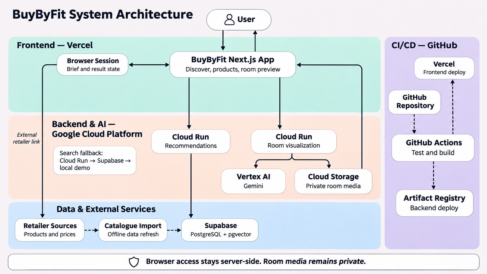
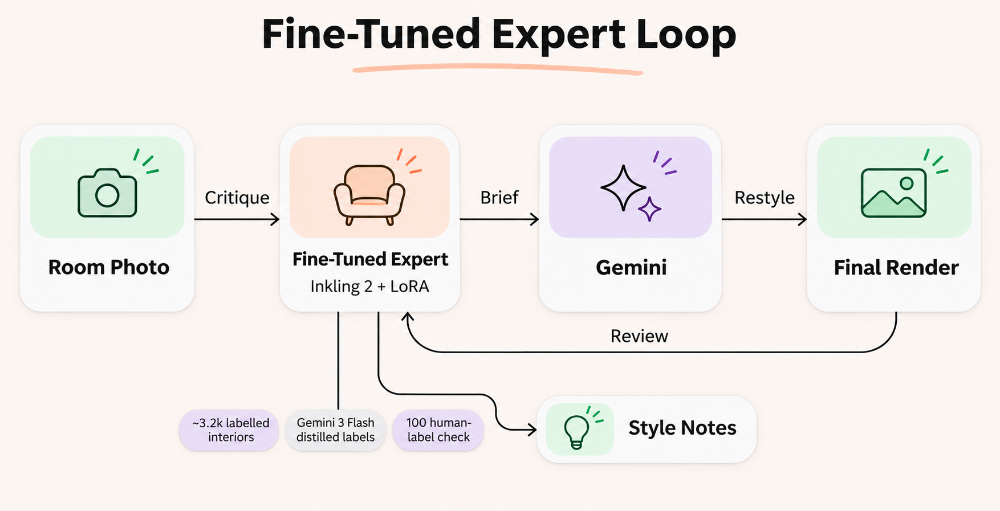

# BuyByFit

BuyByFit is a room-first furniture discovery experience. A visitor describes the room they want to create, reviews pieces matched to that brief and practical constraints, opens the retailer listing when one is available, and can optionally preview selected results in a photo of their own room.

The repository contains the production-oriented web application, its recommendation and room-visualization service, catalogue tooling, and fine-tuning research for the interior-design expert. It is designed to run usefully with no credentials, while supporting a real Supabase catalogue and separately deployed FastAPI services when configured.

## What is implemented

| Capability | Current implementation |
| --- | --- |
| Room-first discovery | Typed room briefs, optional browser voice dictation, budget input, and persistent in-tab results/sort state. |
| Product results | Same-origin `POST /api/v1/searches`, with a real-catalogue, FastAPI, and local-demo fallback strategy. |
| Catalogue product pages | Product details, dimensions, materials, price or estimate, retailer link, related products, and optional 3D/AR viewing. |
| Room restyling | Optional photo upload/capture, room dimensions, asynchronous render progress, download, retry, and structured feedback. When configured, a fine-tuned design expert briefs Gemini and produces style-only notes on the final render. |
| Safety and resilience | Server-only service credentials, explicit fallback behaviour, no client-side database writes, and a usable local fictional catalogue. |

## Data and search modes

The browser always calls the Next.js application on its own origin. The search route selects the first available mode below:

1. **FastAPI recommendation service** — set `RECOMMENDATION_API_URL`; the Next.js route proxies to the Python service.
2. **Supabase catalogue** — set `SUPABASE_URL` and `SUPABASE_ANON_KEY`; the server embeds the brief and calls the `match_products` pgvector function, then retrieves product records through PostgREST.
3. **Local demonstration catalogue** — when neither integration is configured, the application ranks its bundled fictional products. This keeps local development and previews functional without credentials.

Retailer URLs, availability, prices, images, and 3D assets in a live catalogue are source data and can change. A production deployment must treat the retailer page as the source of truth and keep catalogue refresh/verification jobs under the relevant retailer terms.

## Quick start

Requirements: Node.js 20.9+ and npm.

```bash
cd frontend
npm install
npm run dev
```

Open [http://localhost:3000](http://localhost:3000). Before sharing a frontend change, run:

```bash
cd frontend
npm run typecheck
npm run build
```

The app works in local-demo mode with no environment variables. See [frontend/README.md](frontend/README.md) for configuration and route details.

## Repository map

```text
frontend/        Next.js customer experience and same-origin proxy routes
backend/         FastAPI recommendation and room-visualization services
infra/            Local-only catalogue import guidance and infrastructure notes
scraper-worker/  Optional Cloudflare Worker for constrained catalogue collection
ar-mvp/          Standalone AR research prototype; not part of the web deployment
taste/           Training, evaluation, and data tooling for the fine-tuned interior expert
docs/            Architecture, integration, and historical handoff material
```

## Deployment

The frontend deployment mirror is [`JayWu0512/buy-by-fit`](https://github.com/JayWu0512/buy-by-fit). The workflow at [`.github/workflows/sync-vercel-deploy-repo.yml`](.github/workflows/sync-vercel-deploy-repo.yml) mirrors `frontend/` to that repository after `main` changes; Vercel deploys the mirror as a normal Next.js application.

For Vercel, use Node.js 22 LTS, `npm ci`, and `npm run build`. Configure only server-side environment variables from [frontend/.env.example](frontend/.env.example); do not prefix them with `NEXT_PUBLIC_`. The CI workflow validates the frontend type-check/build and backend recommendation tests on pull requests and on `main`.

For the Python service, see [backend/README.md](backend/README.md). A deployed room service is required before the room-restyling flow can process uploads.

## Architecture

```text
Browser
  └─ Next.js frontend and same-origin API routes
       ├─ FastAPI recommendation service (optional)
       │    └─ PostgreSQL + pgvector catalogue
       ├─ Supabase catalogue search (optional)
       ├─ FastAPI room-visualization service (optional)
       │    └─ Vertex AI + private file storage
       └─ Local fictional catalogue (always available fallback)
```



Read [docs/architecture.md](docs/architecture.md) for boundaries and request flow, and [backend/app/api/API_CONTRACT.md](backend/app/api/API_CONTRACT.md) for API shapes.

## Fine-Tuned Interior Expert

The room-restyling pipeline can use a fine-tuned interior-design expert for the Thinking Machines fine-tuning challenge. The model is **Inkling 2 Small with a LoRA adapter**, trained on approximately **3.2k labelled interior images** distilled from Gemini 3 Flash and checked against 100 human labels.

Before Gemini creates the restyle, the expert critiques the photographed room's palette, materials, lighting, and cohesion and passes concise direction into the design step. After the selected render is complete, it returns up to three style-only notes; it does not make product recommendations. The restyling pipeline safely continues without this capability when the reviewer configuration is unavailable.



## Pitch deck

[Open the interactive BuyByFit pitch deck](docs/pitch/BuyByFit_Pitch.html). The presentation is self-contained, so it can be opened locally in a browser without an asset server.

## Engineering practices

- Never commit `.env` files, API keys, database dumps, uploads, generated renders, model files, or build output.
- Keep the public browser API same-origin. Service URLs and Supabase credentials remain server-side.
- Update the API contract and tests with a shared endpoint or response-field change.
- Keep live catalogue sourcing, licensing, retailer terms, availability, and prices explicit; do not present stale estimates as verified prices.
- Read [backend/WORKFLOW.md](backend/WORKFLOW.md) before changing backend contracts or service ownership boundaries.
